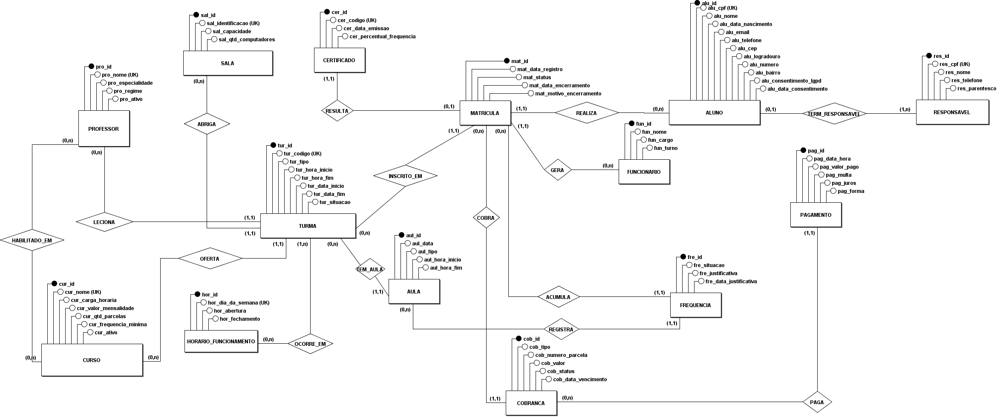
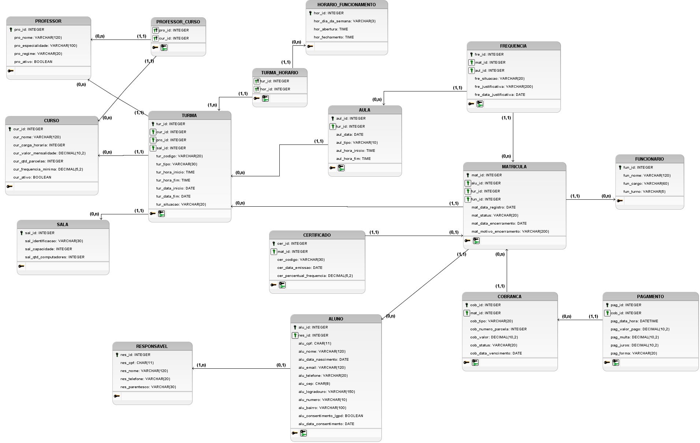

# Sistema de Gestão Microlins — Modelagem de Banco de Dados (Entrega 2)

## Integrantes

| Nome | RGM | GitHub |
| :---- | :---- | :---- |
| João Pedro Paulino Cassimiro | 48109452 | https://github.com/Joao-cyber037 |
| Pedro Enrico Damasceno | 48329487 | https://github.com/PedroDamasceno1312 |
| Vinicius Paes Landim Dias | 48178501 | https://github.com/viniciusdias10 |
| Thais Oliveira | 46578269 | https://github.com/thaisvinicarvalho-coder |
| Kevyn Morais Barros | 48328936 | https://github.com/KevynMorais |

## Índice

1. [Organização real](#1-organização-real)
2. [Entrevista](#2-entrevista)
3. [Números da organização](#3-números-da-organização)
4. [Problemas identificados](#4-problemas-identificados)
5. [Processos de negócio](#5-processos-de-negócio)
6. [Requisitos e regras (RF, RNF, RN)](#6-requisitos-e-regras-rf-rnf-rn)
7. [Ferramentas utilizadas](#7-ferramentas-utilizadas)
8. [Modelo conceitual (DER) e modelo lógico](#8-modelo-conceitual-der-e-modelo-lógico)
9. [Seções técnicas](#9-seções-técnicas)
10. [Apontamentos da Issue #1](#10-apontamentos-da-issue-1)
11. [Links dos arquivos](#11-links-dos-arquivos)
12. [Uso de Inteligência Artificial](#12-uso-de-inteligência-artificial)

---

## 1. Organização real

- **Nome:** Microlins (escola de cursos profissionalizantes), unidade Itaquera
- **Endereço:** Rua Gregório Ramalho, 267 — Itaquera, São Paulo/SP
- **Google Meu Negócio:** https://share.google/Vl8QkhGN6fTIHxk5N
- **Responsável (nome):** José Jerônimo Júnior (coordenador geral)
- **Responsável (telefone):** +55 11 95934-0753
- **Fotos do local:** 
- **Justificativa da escolha:** unidade real, com acesso garantido ao coordenador, a todas as salas e ao sistema de controle (HUB), e com processos acadêmicos, financeiros e de frequência que cobrem o ciclo completo do aluno. O vinculo com a unidade é apenas de aluno.

## 2. Entrevista

> Esta seção registra **o que foi dito** (entrevistado) separado do **que foi visto** (observação do grupo).

| Campo | Registro |
| :---- | :---- |
| Quem foi entrevistado | José Jerônimo Júnior, coordenador geral |
| Quando (data e horário) | 10/09/2026, às 13h30 |
| Onde | Microlins Itaquera, Rua Gregório Ramalho, 267 |
| Integrante que participou | João Pedro Paulino Cassimiro |
| Forma de contato | Entrevista presencial no local e confirmações posteriores por WhatsApp, em 04/11/2026 (prints: [conversa 1](evidencias/conversa%20com%20coordenador1.png) e [conversa 2](evidencias/conversa%20com%20coordenador2.png)) |
| Foto da entrevista/visita |  |

### 2.1 O que foi dito (relato do responsável)

- Dia de vencimento, valor e número de parcelas dependem do contrato de cada matrícula e são definidos pelo responsável da escola.
- Cancelamento: multa de 20% sobre o valor restante do contrato, sem prazo de desistência após a assinatura.
- Trancamento: até 3 meses por ano.
- Atraso: no primeiro dia de atraso a mensalidade recebe acréscimo de 20% (parcela de R$ 290,00 passa a R$ 348,00); a cada dia seguinte soma-se mais 20% do último acréscimo (2º dia: 20% de R$ 58,00 = R$ 11,60, total R$ 359,60). Bloqueio do aluno após 1 mês de atraso.
- Troca de turma: livre e gratuita.
- Faltas: máximo de 3 por módulo, senão o aluno repete; falta não justificada custa R$ 40,00 para repor; falta justificada tem reposição gratuita em qualquer dia e horário. A presença é registrada pelo professor.
- A escola emite certificado.
- Idade mínima de 14 anos; o contrato sempre é assinado pelo responsável; o aluno pode estar em quantas turmas e cursos quiser; o professor pode dar aula em 2 turmas ao mesmo tempo.
- Funcionamento das 08h às 18h, com turmas em blocos de 2 horas. A turma extra só ocorre às terças e quintas, entre 10h e 16h.
- 4 salas: 3 com 15 computadores (15 alunos por horário) e 1 com capacidade para 25 alunos, sem computadores, que só funciona às terças e quintas (aula extra).
- Cada curso dura em torno de 2 anos. O material didático está embutido na mensalidade: a secretaria envia o contrato do aluno à MovEDU, que fornece as apostilas, e o professor pede a apostila conforme o aluno avança nos módulos (confirmado por WhatsApp em 04/11/2026).
- Dados dos alunos são coletados só para o contrato e, depois, para contato com o responsável ou acionamento de emergência.

### 2.2 O que foi observado (pelo grupo, no local)

O integrante João Pedro visitou a unidade, viu todas as salas de aula e teve acesso aos computadores (com exceção da sala da diretora), ao endereço IP da rede, ao rack e ao servidor da unidade. O coordenador José Jerônimo Júnior também permitiu o acesso ao sistema de controle que a organização usa (HUB).

### 2.3 Levantamento

O levantamento completo, organizado por tema (estrutura da unidade, matrícula, cobrança e atraso, frequência, material, processos fora do modelo e regras), está em [`levantamento/levantamento_1.md`](levantamento/levantamento_1.md). Resumo:

- **Fontes:** entrevista presencial de 10/09/2026, observação do local e confirmações por WhatsApp em 04/11/2026.
- **Achado principal:** a unidade controla o ciclo acadêmico e a receita do aluno; contas, manutenção, limpeza e folha de pagamento são da matriz.
- **Regras levantadas:** horário das 08h às 18h, 4 salas, idade mínima de 14 anos, contrato assinado por responsável, atraso com acréscimo diário, cancelamento com multa de 20%, trancamento de até 3 meses por ano e reposição de faltas.
- **O que mudou em relação à Entrega 1:** matrícula de 1 aluno por turma e novas entidades (responsável, aula, frequência, pagamento e certificado).

## 3. Números da organização

Fonte: **responsável da organização**.

| Indicador | Valor informado | Observação |
| :---- | :---- | :---- |
| Salas | 4 (3 com 15 computadores; 1 com capacidade para 25 e sem computadores, só ter/qui) | informado pelo responsável |
| Duração dos cursos | cerca de 2 anos | informado pelo responsável |
| Colaboradores | 25 no total | informado pelo responsável |
| Colaboradores por setor | 8 professores, 3 secretárias, 2 diretores, 1 coordenador geral, 2 balconistas, 7 no financeiro e 2 na limpeza | informado pelo responsável |
| Alunos | 477 por mês | informado pelo responsável |
| Faturamento mensal | de R$ 192.193,33 a R$ 287.526,67 (depende do contrato do aluno) | informado pelo responsável |

## 4. Problemas identificados

Cada problema aponta as entidades do DER que o resolvem e as consultas do [`script.sql`](docs/script.sql) que o demonstram. As consultas **G01 a G14** são gerenciais e as **A01 a A17** são de auditoria.

| ID | Problema | Entidades no DER | Consultas no script |
| :---- | :---- | :---- | :---- |
| P1 | Alunos perdem o horário gravado no sistema | MATRICULA, TURMA, TURMA_HORARIO | `A08` e `A16` (matrícula presa a uma turma com horário; matrícula ativa em turma encerrada) |
| P2 | Perda frequente de matrículas | MATRICULA, ALUNO, FUNCIONARIO | `G07` (evasão por curso) e `G10` (matrículas por funcionário) |
| P3 | Sem histórico consolidado de pagamentos | COBRANCA, PAGAMENTO, MATRICULA | `G01`, `G02`, `G05`, `G08`, `G09`, `G13` e `G14` |
| P4 | Sistema não justifica faltas, mesmo tendo a tela | FREQUENCIA, AULA | `G04`, `G06` e `G12` (`fre_situacao = FALTA_JUSTIFICADA`, `fre_justificativa` e `fre_data_justificativa`) |
| P5 | Sobreposição e lotação de salas e horários | TURMA, SALA, TURMA_HORARIO | `G03`, `G11`, `A03` e `A12` |
| P6 | Endereços digitados de forma desorganizada | ALUNO | Prevenido por `NOT NULL` em `alu_cep`, `alu_logradouro`, `alu_numero` e `alu_bairro` (o banco não aceita endereço incompleto) |

Exemplo (P3, consulta G14 do script — maiores devedores e contato para cobrança):

```sql
-- G14 Quem são os 10 maiores devedores e qual o contato para cobrança (responsável, se menor)?
-- Atende: P3 (sem histórico consolidado de pagamentos: maiores devedores)
WITH devedores AS (
    SELECT m.alu_id,
           COUNT(*) AS cobrancas_em_atraso,
           SUM(cb.cob_valor - IFNULL(p.principal_pago, 0)) AS saldo_devedor,
           MIN(cb.cob_data_vencimento) AS vencimento_mais_antigo
    FROM COBRANCA cb
    JOIN MATRICULA m ON m.mat_id = cb.mat_id
    LEFT JOIN (SELECT cob_id, SUM(pag_valor_pago - pag_multa - pag_juros) AS principal_pago
               FROM PAGAMENTO GROUP BY cob_id) p ON p.cob_id = cb.cob_id
    WHERE cb.cob_status IN ('ABERTA','VENCIDA')
      AND cb.cob_data_vencimento < @data_ref
    GROUP BY m.alu_id
)
SELECT a.alu_nome AS aluno,
       IFNULL(r.res_nome, a.alu_nome) AS contato_para_cobranca,
       IFNULL(r.res_telefone, a.alu_telefone) AS telefone_para_cobranca,
       d.cobrancas_em_atraso,
       d.saldo_devedor,
       d.vencimento_mais_antigo
FROM devedores d
JOIN ALUNO a ON a.alu_id = d.alu_id
LEFT JOIN RESPONSAVEL r ON r.res_id = a.res_id
ORDER BY d.saldo_devedor DESC, a.alu_nome
LIMIT 10;
```

## 5. Processos de negócio

### 5.1 Processos modelados

| Processo | Fluxo | Entidades envolvidas |
| :---- | :---- | :---- |
| PR1 | Coordenação cadastra cursos, salas, horários de funcionamento e professores (com habilitação) → abre a turma, com sala, professor e dias | CURSO, SALA, HORARIO_FUNCIONAMENTO, PROFESSOR, PROFESSOR_CURSO, TURMA, TURMA_HORARIO |
| PR2 | Interessado procura a escola (balcão/telefone) → atendimento cadastra o aluno com endereço completo e consentimento LGPD → se menor, vincula o responsável | ALUNO, RESPONSAVEL |
| PR3 | Ao fechar o contrato, a secretaria envia o contrato do aluno à MovEDU → o professor pede a apostila conforme o aluno avança nos módulos (o valor está embutido na mensalidade) | MATRICULA, TURMA (a MovEDU não é entidade do modelo) |
| PR4 | Aluno com no mínimo 14 anos → funcionário gera a matrícula em uma turma aberta, respeitando a capacidade da sala → contrato assinado pelo responsável → matrícula `ATIVA` | MATRICULA, FUNCIONARIO, TURMA, ALUNO |
| PR5 | A matrícula gera a taxa e as parcelas de mensalidade conforme o curso (valor e número de parcelas) | COBRANCA, CURSO |
| Recebimento, atraso e baixa | Cada pagamento baixa uma cobrança (parcial ou total) → em atraso, incidem multa de 20% e juros de 20% sobre a multa → a cobrança vencida fica `VENCIDA` | PAGAMENTO, COBRANCA |
| PR6 | A turma programa as aulas (regulares ou de reposição) → o professor registra presença ou falta de cada matrícula → a falta pode receber justificativa | AULA, FREQUENCIA |
| PR7 | Aluno pede troca → a matrícula atual é encerrada com data e motivo e uma nova é gerada na outra turma, sem custo, mantendo o histórico | MATRICULA |
| PR8 | A matrícula muda de status (`CANCELADA` ou `TRANCADA`) com data e motivo de encerramento; nada é apagado | MATRICULA, COBRANCA |
| PR9 | Atingida a frequência mínima do curso, a matrícula passa a `CONCLUIDA` e o certificado é emitido com código de autenticação e percentual apurado | MATRICULA, FREQUENCIA, CURSO, CERTIFICADO |
| PR10 | Professor habilitado no curso é alocado às turmas; pode lecionar até 2 turmas ao mesmo tempo | PROFESSOR, PROFESSOR_CURSO, TURMA |

### 5.2 Processos fora do modelo e justificativa

| Processo | Por que ficou de fora |
| :---- | :---- |
| Compra e entrega de apostilas | O valor do material está embutido na mensalidade. A secretaria envia o contrato à MovEDU, que fornece as apostilas; a unidade não controla estoque nem compra |
| Cobrança de reposição (R$ 40,00), multa de cancelamento (20%) e bloqueio por atraso | O responsável informou as regras, mas o dicionário v1.5 não tem entidade para elas. A reposição existe como `AULA` do tipo `REPOSICAO`; o valor da multa e o bloqueio são calculados pela secretaria a partir de `COBRANCA` e `PAGAMENTO` (consultas G09 e G14). Ficam como evolução do modelo |
| Contas a pagar e fornecedores (energia, água, internet, aluguel) | Segundo o coordenador José Jerônimo Júnior, em conversa de 04/11/2026, as contas de água e luz e os demais pagamentos são feitos pela matriz da Microlins, não pela unidade Itaquera |
| Manutenção de laboratórios e computadores | A diretora chama uma empresa contratada pela Microlins e o pagamento é feito pela matriz (conversa de 04/11/2026) |
| Limpeza | É feita por empresa contratada pela Microlins e paga pela matriz (conversa de 04/11/2026) |
| Folha de pagamento | Tratada pela matriz. O modelo só guarda o professor e o funcionário que geram turmas e matrículas |

> Evidência das confirmações: [`evidencias/conversa com coordenador1.png`](evidencias/conversa%20com%20coordenador1.png) e [`evidencias/conversa com coordenador2.png`](evidencias/conversa%20com%20coordenador2.png), de 04/11/2026.

## 6. Requisitos e regras (RF, RNF, RN)

### 6.1 Requisitos funcionais

| ID | Requisito | Implementação |
| :---- | :---- | :---- |
| RF01 | Cadastrar aluno (contato e endereço completo) e responsável | `ALUNO`, `RESPONSAVEL` |
| RF02 | Gerar matrícula do aluno em uma turma e vinculá-la a cobranças | `MATRICULA`, `COBRANCA.mat_id` |
| RF03 | Alocar turmas em sala, professor e dias respeitando a capacidade e os blocos de 2h | `TURMA`, `TURMA_HORARIO`, `SALA`, consulta `A03` |
| RF04 | Registrar frequência (pelo professor) e justificar faltas | `FREQUENCIA` |
| RF05 | Cancelar, trancar e concluir matrícula sem apagar histórico | `MATRICULA.mat_status`, `mat_data_encerramento`, `mat_motivo_encerramento` |
| RF06 | Programar reposição de aulas | `AULA.aul_tipo = 'REPOSICAO'` |
| RF07 | Trocar o aluno de turma mantendo histórico | encerramento da matrícula anterior e nova `MATRICULA` |
| RF08 | Registrar pagamentos totais ou parciais com multa e juros | `PAGAMENTO` |
| RF09 | Emitir certificado ao atingir a frequência mínima | `CERTIFICADO`, `CURSO.cur_frequencia_minima` |

### 6.2 Requisitos não funcionais

| ID | Requisito | Implementação |
| :---- | :---- | :---- |
| RNF01 | Integridade: chaves estrangeiras com `ON DELETE RESTRICT`, histórico preservado | `FOREIGN KEY` em todas as tabelas |
| RNF02 | Consistência de domínio: status, tipos e horários com valores válidos | `CHECK ... IN (...)` para os domínios, `NOT NULL` e `DEFAULT` |
| RNF03 | Acentuação correta | `utf8mb4` com collation `utf8mb4_0900_ai_ci` |
| RNF04 | LGPD: finalidade restrita, consentimento e minimização | ver 6.4 |

### 6.3 Regras de negócio

Valores e prazos foram informados pelo responsável da organização (ver 2.1). A coluna **Garantia** diz onde a regra é aplicada: no `CREATE TABLE`, em uma consulta de auditoria (`A##` do `script.sql`) ou na operação da escola.

| ID | Regra | Por que importa | Garantia |
| :---- | :---- | :---- | :---- |
| RN01 | Operação entre 08:00 e 18:00 | A escola só funciona nesse intervalo | `CHECK` em `TURMA` e `A10` |
| RN02 | Turma ocupa bloco de 2 horas | Padrão da grade | `CHECK ck_turma_bloco_2h` em `TURMA` |
| RN03 | Turma extra só ocorre às terças e quintas, entre 10:00 e 16:00 | A sala extra só abre nesses dias | `A14` |
| RN04 | Existem 4 salas: 3 com 15 lugares e 1 com 25 (só ter/qui). A capacidade vale por sala em cada dia e horário, somando todas as turmas ali | Nas salas comuns cada aluno usa um computador (15); a sala extra tem 25 lugares e não tem computadores | `A03` e `G03` |
| RN05 | Turma só existe com professor habilitado no curso | Impede aula sem docente qualificado | `PROFESSOR_CURSO` e `A02` |
| RN06 | Professor pode dar aula em até 2 turmas ao mesmo tempo | Prática da escola | `A12` |
| RN07 | Aluno pode estar em quantas turmas e cursos quiser (uma matrícula por turma) | Flexibilidade informada pelo responsável | `MATRICULA` (N matrículas por aluno) |
| RN08 | Idade mínima de 14 anos na data da matrícula | Política da escola | `A13` |
| RN09 | O contrato é assinado por um responsável | O responsável é o contato e o signatário | `A01` |
| RN10 | Valor da mensalidade, número de parcelas e frequência mínima são definidos pelo curso | Simplificação do modelo (o responsável disse que variam por contrato; ver 9.5) | `CURSO` |
| RN11 | Cancelamento, trancamento e conclusão mudam o status com data e motivo, sem apagar histórico | Preserva o histórico | `MATRICULA.mat_status` |
| RN12 | Cancelamento: multa de 20% do valor restante do contrato, sem prazo de desistência | Política da escola | Operação da secretaria (fora do modelo; ver 5.2) |
| RN13 | Atraso: no 1º dia incide multa de 20% da parcela (`pag_multa`); a cada dia seguinte soma-se 20% do último acréscimo (somados em `pag_juros`). Ex.: parcela de R$ 290,00 → R$ 348,00 no 1º dia, R$ 359,60 no 2º, R$ 361,92 no 3º; tende a R$ 362,50 (125% da parcela) | Define o valor devido | `PAGAMENTO` e `G13` |
| RN14 | Com 1 mês de atraso o aluno é bloqueado | Política de inadimplência | Operação, apoiada por `G09` e `G14` |
| RN15 | Trancamento de até 3 meses por ano | Política da escola | Operação da secretaria (informativa) |
| RN16 | Falta justificada conta como presença no cálculo da frequência | Direito do aluno | `G04`, `G12` e inserção em lote (4.3 do script) |
| RN17 | Cobrança aberta após o vencimento passa a `VENCIDA` | Controle de inadimplência | `UPDATE` 4.1 do script |
| RN18 | Máximo de 3 faltas por módulo; no modelo, o critério é o percentual mínimo de frequência do curso | Regra acadêmica (o módulo não é entidade) | `CURSO.cur_frequencia_minima` e `G04` |
| RN19 | Falta não justificada: reposição custa R$ 40,00 | Receita e controle de faltas | Operação da escola (fora do modelo; ver 5.2) |
| RN20 | Falta justificada: reposição gratuita em qualquer dia e horário | Direito do aluno | `AULA.aul_tipo = 'REPOSICAO'` |
| RN21 | Quem registra a presença é o professor da turma | Responsabilidade clara | `TURMA.pro_id` |
| RN22 | Dados pessoais só com finalidade restrita e consentimento registrado | LGPD | `A04` |
| RN23 | Certificado exige a frequência mínima do curso | Validade da conclusão | `A05`, `A06` e `A07` |
| RN24 | Cobrança `PAGA` tem o principal quitado, sem pagamento a maior | Integridade financeira | `A11` |
| RN25 | A frequência pertence à matrícula da mesma turma da aula | Consistência acadêmica | `A08` |
| RN26 | Aula regular ocorre somente nos dias da turma | Grade respeitada | `A09` |
| RN27 | Só se oferta turma com curso ativo e professor ativo | Catálogo vigente | `A15` |
| RN28 | Turma encerrada ou cancelada não mantém matrícula ativa | Evita matrícula "fantasma" | `A16` |
| RN29 | Matrícula ativa gera cobranças | Sem receita esquecida | `A17` |
| RN30 | Os dados pessoais do aluno são apagados de todos os registros assim que o contrato termina | Cláusula de LGPD do contrato; há multa indenizatória se não forem eliminados | Operação da escola (fora do modelo; ver 6.4) |

**Pontos de atenção (para o grupo discutir, não para esconder):**

- **RN13:** o Código de Defesa do Consumidor (art. 52, §1º) limita a multa por atraso a 2%, e decisões judiciais aplicam esse limite a mensalidades escolares. A escola informou 20% no primeiro dia, com acréscimo diário. O trabalho registra a regra **como a escola pratica**, mas deixa claro que ela pode ser contestada. Esta não é opinião jurídica.
- **RN12:** a multa de 20% sobre o saldo restante e a ausência de prazo de desistência também podem ser questionadas em contratos de consumo. Mesmo tratamento: registrar a prática.

### 6.4 LGPD

| Medida | Aplicação |
| :---- | :---- |
| Finalidade | Dados do aluno são usados só para o contrato, contato com o responsável e acionamento de emergência (informado pela escola) |
| Minimização | Coletar apenas CPF, nome, nascimento, telefone, e-mail (opcional) e endereço do aluno; CPF, nome, telefone e parentesco do responsável |
| Menores de idade | Alunos a partir de 14 anos; o responsável assina o contrato e é o contato (`RESPONSAVEL`, ligado por `ALUNO.res_id`) |
| Papéis | O contrato define a Microlins como **controladora** dos dados e atribui as responsabilidades (informado pela escola) |
| Segurança | O contrato exige medidas técnicas e administrativas de proteção dos dados, como criptografia e controle de acesso |
| Eliminação | Os dados pessoais do aluno são **apagados de todos os registros da Microlins assim que o contrato é finalizado**; se não forem eliminados, a escola pode pagar multa indenizatória (cláusula do contrato) |
| Consentimento | `alu_consentimento_lgpd` e `alu_data_consentimento`, verificados pela consulta `A04` |
| Acesso restrito | Papéis por entidade e operação definidos no dicionário de dados (seção 6): atendimento, professor, financeiro, coordenação e auditoria |
| Rastreabilidade | Log de acesso do SGBD e versionamento do dicionário (art. 6º, X) |

## 7. Ferramentas utilizadas

- **DER e modelo lógico:** brModelo
- **Banco de dados:** MySQL 8.0.16 ou superior (o `script.sql` deve ser executado do zero no MySQL Workbench; o *Action Output* não pode mostrar erros)
- **Dicionário de dados:** arquivo HTML único (`dicionario-dados-microlins.html`, na raiz), versão 1.5
- **Versionamento:** Git / GitHub

## 8. Modelo conceitual (DER) e modelo lógico

### 8.1 Modelo conceitual (DER)



O DER não exibe chaves estrangeiras (elas aparecem só no modelo lógico). As cardinalidades seguem o padrão do brModelo, no formato **(mínimo, máximo)** ao lado de cada entidade.

| Relacionamento | Entidades e cardinalidade | Tipo | Leitura |
| :---- | :---- | :---- | :---- |
| HABILITADO_EM | PROFESSOR (0,n) — CURSO (0,n) | N:N | Um professor pode estar habilitado em 0 a n cursos; um curso pode ter 0 a n professores habilitados |
| LECIONA | PROFESSOR (0,n) — TURMA (1,1) | 1:N | Cada turma é lecionada por exatamente 1 professor |
| ABRIGA | SALA (0,n) — TURMA (1,1) | 1:N | Cada turma ocorre em exatamente 1 sala |
| OFERTA | CURSO (0,n) — TURMA (1,1) | 1:N | Cada turma pertence a exatamente 1 curso |
| OCORRE_EM | TURMA (1,n) — HORARIO_FUNCIONAMENTO (0,n) | N:N | Cada turma ocorre em 1 a n dias de funcionamento |
| TEM_AULA | TURMA (0,n) — AULA (1,1) | 1:N | Cada aula pertence a exatamente 1 turma |
| INSCRITO_EM | MATRICULA (1,1) — TURMA (0,n) | 1:N | Cada matrícula inscreve o aluno em exatamente 1 turma |
| REALIZA | MATRICULA (1,1) — ALUNO (0,n) | 1:N | Cada matrícula pertence a exatamente 1 aluno |
| GERA | MATRICULA (1,1) — FUNCIONARIO (0,n) | 1:N | Cada matrícula é gerada por exatamente 1 funcionário |
| RESULTA | CERTIFICADO (1,1) — MATRICULA (0,1) | 1:1 | Cada certificado resulta de exatamente 1 matrícula; cada matrícula tem 0 ou 1 certificado |
| TERM_RESPONSAVEL | ALUNO (0,1) — RESPONSAVEL (1,n) | 1:N | Cada aluno tem 0 ou 1 responsável; cada responsável responde por 1 a n alunos |
| COBRA | COBRANCA (1,1) — MATRICULA (0,n) | 1:N | Cada cobrança refere-se a exatamente 1 matrícula |
| ACUMULA | FREQUENCIA (1,1) — MATRICULA (0,n) | 1:N | Cada registro de frequência pertence a exatamente 1 matrícula |
| REGISTRA | FREQUENCIA (1,1) — AULA (0,n) | 1:N | Cada registro de frequência refere-se a exatamente 1 aula |
| PAGA | PAGAMENTO (1,1) — COBRANCA (0,n) | 1:N | Cada pagamento quita exatamente 1 cobrança; uma cobrança pode receber vários pagamentos (parciais) |

### 8.2 Modelo lógico (brModelo)



O modelo lógico tem as **14 entidades** do DER mais as **2 tabelas associativas** (`PROFESSOR_CURSO` e `TURMA_HORARIO`), resultantes dos relacionamentos N:N, totalizando **16 tabelas**. As cardinalidades seguem a notação (mínimo, máximo) e os nomes de colunas seguem o dicionário de dados (prefixo da entidade, `<prefixo>_id` como chave primária, chave estrangeira com o mesmo nome da chave referenciada).

## 9. Seções técnicas

### 9.1 (1.1) Visão conceitual

Entidades: ALUNO, RESPONSAVEL, PROFESSOR, FUNCIONARIO, CURSO, TURMA, SALA, HORARIO_FUNCIONAMENTO, MATRICULA, AULA, FREQUENCIA, COBRANCA, PAGAMENTO e CERTIFICADO. A MATRICULA é a entidade central: ela liga o aluno à turma e dela decorrem cobranças, frequência e certificado.

### 9.2 (1.2) Conversão do modelo conceitual para o lógico

| Conceitual | Lógico | Regra aplicada |
| :---- | :---- | :---- |
| Entidade | Tabela | 1 entidade = 1 tabela |
| Relacionamento 1:N | Chave estrangeira no lado N | `MATRICULA.alu_id`, `COBRANCA.mat_id`, `PAGAMENTO.cob_id` |
| Relacionamento N:N | Tabela associativa com PK composta | `PROFESSOR_CURSO (pro_id, cur_id)` e `TURMA_HORARIO (tur_id, hor_id)` |
| Relacionamento 1:1 | FK com restrição `UNIQUE` | `CERTIFICADO.mat_id` |
| Relacionamento opcional (0,1) | FK que aceita `NULL` | `ALUNO.res_id` |
| Atributo de endereço | Colunas atômicas | `alu_cep`, `alu_logradouro`, `alu_numero`, `alu_bairro` |

### 9.3 (1.3) Chaves primárias e estrangeiras

| Tabela | PK | FKs |
| :---- | :---- | :---- |
| PROFESSOR | `pro_id` | — |
| CURSO | `cur_id` | — |
| HORARIO_FUNCIONAMENTO | `hor_id` | — |
| SALA | `sal_id` | — |
| FUNCIONARIO | `fun_id` | — |
| RESPONSAVEL | `res_id` | — |
| ALUNO | `alu_id` | `res_id` (opcional) |
| TURMA | `tur_id` | `cur_id`, `pro_id`, `sal_id` |
| MATRICULA | `mat_id` | `alu_id`, `tur_id`, `fun_id` |
| AULA | `aul_id` | `tur_id` |
| FREQUENCIA | `fre_id` | `mat_id`, `aul_id` |
| COBRANCA | `cob_id` | `mat_id` |
| PAGAMENTO | `pag_id` | `cob_id` |
| CERTIFICADO | `cer_id` | `mat_id` (única) |
| PROFESSOR_CURSO | (`pro_id`, `cur_id`) | `pro_id`, `cur_id` |
| TURMA_HORARIO | (`tur_id`, `hor_id`) | `tur_id`, `hor_id` |

Chaves únicas (UK): `pro_nome`, `cur_nome`, `hor_dia_da_semana`, `sal_identificacao`, `res_cpf`, `alu_cpf`, `tur_codigo`, `cer_codigo`, `CERTIFICADO.mat_id` e o par (`mat_id`, `aul_id`) em FREQUENCIA.

O script completo de criação das 16 tabelas está em [`docs/script.sql`](docs/script.sql). Trecho de exemplo:

```sql
CREATE TABLE MATRICULA (
    mat_id                  INTEGER       NOT NULL AUTO_INCREMENT,
    alu_id                  INTEGER       NOT NULL,
    tur_id                  INTEGER       NOT NULL,
    fun_id                  INTEGER       NOT NULL,
    mat_data_registro       DATE          NOT NULL DEFAULT (CURDATE()),
    mat_status              VARCHAR(20)   NOT NULL DEFAULT 'ATIVA',
    mat_data_encerramento   DATE          NULL,
    mat_motivo_encerramento VARCHAR(200)  NULL,
    CONSTRAINT pk_matricula PRIMARY KEY (mat_id),
    CONSTRAINT ck_matricula_status CHECK (mat_status IN ('ATIVA','TRANCADA','CANCELADA','CONCLUIDA')),
    CONSTRAINT ck_matricula_encerramento CHECK (
        (mat_status = 'ATIVA' AND mat_data_encerramento IS NULL)
        OR (mat_status <> 'ATIVA' AND mat_data_encerramento IS NOT NULL)
    ),
    INDEX idx_matricula_alu_id (alu_id),
    INDEX idx_matricula_tur_id (tur_id),
    INDEX idx_matricula_fun_id (fun_id),
    INDEX idx_matricula_status (mat_status),
    CONSTRAINT fk_matricula_aluno FOREIGN KEY (alu_id) REFERENCES ALUNO (alu_id)
        ON DELETE RESTRICT ON UPDATE RESTRICT,
    CONSTRAINT fk_matricula_turma FOREIGN KEY (tur_id) REFERENCES TURMA (tur_id)
        ON DELETE RESTRICT ON UPDATE RESTRICT,
    CONSTRAINT fk_matricula_funcionario FOREIGN KEY (fun_id) REFERENCES FUNCIONARIO (fun_id)
        ON DELETE RESTRICT ON UPDATE RESTRICT
) ENGINE=InnoDB DEFAULT CHARSET=utf8mb4 COLLATE=utf8mb4_0900_ai_ci;
```

### 9.4 (1.4) Normalização

| Forma normal | Verificação |
| :---- | :---- |
| 1FN | Todos os atributos são atômicos; o endereço do aluno está decomposto em 4 colunas |
| 2FN | Sem dependência parcial: as tabelas de PK composta (`PROFESSOR_CURSO`, `TURMA_HORARIO`) só têm as chaves |
| 3FN | A capacidade vive em `SALA`; curso, professor e sala são obtidos pela `TURMA`; o valor total do curso é calculado (`cur_valor_mensalidade × cur_qtd_parcelas`) em vez de armazenado |

`HORARIO_FUNCIONAMENTO` guarda só a janela de funcionamento da escola em cada dia; o horário real da turma fica em `TURMA` (`tur_hora_inicio` e `tur_hora_fim`) e os dias em `TURMA_HORARIO`.

### 9.5 (1.5) Justificativas técnicas e alternativas

| Decisão | Alternativa descartada | Por que |
| :---- | :---- | :---- |
| MATRICULA como entidade central | Ligar ALUNO direto a TURMA e COBRANCA | Perderia o histórico quando o aluno trocasse de turma e não haveria onde ancorar cobranças, frequência e certificado |
| 1 matrícula = 1 aluno em 1 turma | Matrícula com vários alunos (Entrega 1) | O aluno pode estar em quantas turmas quiser; cada turma é uma matrícula, com histórico próprio |
| 1 matrícula → N cobranças | 1 cobrança por matrícula | Mensalidades, taxa e material são recorrentes; é o que forma o histórico de pagamentos |
| PAGAMENTO separado de COBRANCA | Atributos de pagamento dentro da cobrança | Uma cobrança pode ter pagamentos parciais, e multa e juros pertencem ao ato de pagar |
| Valor, parcelas e frequência mínima no CURSO | Tabela CONTRATO por matrícula | O responsável disse que valores variam por contrato, mas o dicionário v1.5 padroniza por curso. Se o grupo quiser contratos individuais, vira CONTRATO |
| Reposição como `AULA` do tipo `REPOSICAO` | Entidade REPOSICAO própria | Simplifica: a reposição já tem turma, data e horário, e gera `FREQUENCIA` como qualquer aula |
| Capacidade em SALA e contada por dia e horário | Capacidade fixa na TURMA | O limite é físico, da sala (15 computadores nas salas comuns; 25 lugares na sala extra) |
| `TURMA_HORARIO` (N:N) | Colunas de dia da semana em TURMA | Uma turma ocorre em vários dias da semana; a associativa mantém o 1FN |
| Cancelar, trancar e concluir por status | `DELETE` | Histórico imutável |
| `UNIQUE` em `CERTIFICADO.mat_id` | Apenas índice comum | Garante o 1:1 do relacionamento RESULTA (acréscimo em relação ao texto do dicionário v1.5) |
| Regras em `CHECK`, `FK` e consultas de auditoria | Triggers para tudo | Regras estruturais ficam no `CREATE TABLE`; as regras entre linhas (capacidade, professor em 2 turmas) são verificadas pelas auditorias `A01` a `A17` |

### 9.6 (1.6) BI e IA, com rastreabilidade

| Pergunta de negócio | Indicador | Origem (tabelas) | Consulta | Problema ligado |
| :---- | :---- | :---- | :---- | :---- |
| Quanto da receita está em atraso? | Inadimplência por curso e aging | COBRANCA, MATRICULA, TURMA, CURSO | `G02`, `G09` | P3 |
| Quais salas e horários estão lotados ou vazios? | Taxa de ocupação | MATRICULA, TURMA, SALA, TURMA_HORARIO | `G03`, `G11` | P1, P5 |
| Quais cursos têm mais cancelamentos e trancamentos? | Evasão por curso | MATRICULA, TURMA, CURSO | `G07` | P2 |
| Quem está abaixo da frequência mínima? | Frequência por aluno | FREQUENCIA, AULA, MATRICULA | `G04`, `G12` | P4 |
| Quanto a escola recebe e por qual forma de pagamento? | Receita por mês e forma | PAGAMENTO | `G05`, `G08`, `G13` | P3 |
| Quem tem risco de evasão? (IA) | Score a partir de faltas e atrasos | FREQUENCIA, COBRANCA, PAGAMENTO | — | P2, P3, P4 |

O grupo não vai implementar dashboard nem modelo de IA; é apenas uma proposta de uso futuro.

### 9.7 (2.x) Como executar o script

1. Abrir o arquivo [`docs/script.sql`](docs/script.sql) no MySQL Workbench (MySQL 8.0.16 ou superior).
2. Executar o arquivo **inteiro** com o botão do raio, **sem selecionar nenhum trecho** (a variável `@data_ref` precisa existir na mesma sessão).
3. O script recria o banco `microlins` do zero, cria as 16 tabelas, insere os dados fictícios, executa `UPDATE`/`DELETE`, e roda as consultas gerenciais (`G01` a `G14`) e de auditoria (`A01` a `A17`).
4. O resultado esperado de cada consulta de auditoria está no cabeçalho do script (as anomalias foram plantadas de propósito para que a auditoria tenha o que encontrar).

### 9.8 (4) Massa de dados e volume

A massa de dados está no próprio [`docs/script.sql`](docs/script.sql), na seção 3 (`INSERT INTO`), logo depois do `CREATE TABLE`. Todos os nomes, CPFs, telefones e e-mails são **fictícios**; nenhum dado real de aluno da unidade foi usado. Os volumes seguem os números informados pelo responsável (seção 3):

| Tabela | Linhas | Como o volume real justifica |
| :---- | :---- | :---- |
| HORARIO_FUNCIONAMENTO | 5 | Segunda a sexta, das 08h às 18h (premissa: a escola informou o horário, mas não os dias) |
| SALA | 4 | Número real: 3 salas de 15 lugares com 15 computadores e 1 sala de 25 lugares, sem computadores (só ter/qui) |
| CURSO | 10 | Catálogo representativo de cursos profissionalizantes, com pelo menos uma turma por curso ativo |
| PROFESSOR | 8 | Número real de professores |
| FUNCIONARIO | 8 | Amostra dos 15 colaboradores administrativos (secretaria, balcão, financeiro, coordenação), que geram matrículas |
| PROFESSOR_CURSO | 16 | Cada professor habilitado em 2 cursos, em média |
| ALUNO | 100 | Cerca de 21% dos 477 alunos por mês: amostra suficiente para exercitar todas as regras sem inflar o banco |
| RESPONSAVEL | 11 | Responsáveis dos alunos menores de idade (o cadastro admite aluno adulto sem responsável, como no dicionário) |
| TURMA | 16 | Ocupam as 4 salas em vários horários, com turmas lotadas, extras (ter/qui) e encerradas |
| TURMA_HORARIO | 31 | Cada turma ocorre em 1 a 3 dias da semana |
| MATRICULA | 182 | 1,8 matrícula por aluno, pois o aluno pode estar em quantas turmas quiser |
| AULA | 264 | Aulas regulares e de reposição das turmas em andamento e encerradas |
| FREQUENCIA | 3.394 | Um registro por matrícula em cada aula |
| COBRANCA | 863 | Mensalidades por matrícula, conforme o número de parcelas do curso |
| PAGAMENTO | 279 | Pagamentos em dia, em atraso (com o acréscimo diário da RN13) e parciais |
| CERTIFICADO | 22 | Concluintes com a frequência mínima do curso |

**Variedade de cenários:** turmas lotadas (100% das 15 vagas), alunos inadimplentes, pagamentos em dia, atrasados e parciais, formas de pagamento diferentes (PIX, boleto, cartão de crédito e débito, dinheiro), aprovados e reprovados por falta, matrículas ativas, trancadas, canceladas e concluídas, menores com responsável e adultos sem responsável, e registros em meses diferentes.

**Anomalias plantadas de propósito:** o script contém inconsistências pontuais (por exemplo, um menor sem responsável, uma turma com professor sem habilitação e uma sala acima da capacidade) para que cada consulta de auditoria `A01` a `A17` tenha o que encontrar. O cabeçalho do script lista cada uma.

**Uso de IA:** a massa foi gerada com Claude por um programa de geração com semente fixa, e as regras do coordenador (4 salas, 08h às 18h, atraso com acréscimo diário) foram aplicadas por correção do grupo. Detalhes na seção 12.

## 10. Apontamentos da Issue #1

Um item para cada um dos 12 critérios da avaliação da Issue #1. "FEITO" = já está nesta entrega. "PENDENTE" = depende de ação do grupo fora deste arquivo.

| # | Critério (apontamento da Issue) | O que mudou | Por quê |
| :---- | :---- | :---- | :---- |
| 1 | README: o arquivo `readme.md` em minúsculas contaria como ausente | PENDENTE: renomear para `README.md` na raiz da `main`. No Windows/macOS use `git mv readme.md tmp.md && git mv tmp.md README.md` | A rubrica exige o nome exato |
| 2 | Integrantes: 5 com nome e RGM | FEITO: tabela com RGM e GitHub. PENDENTE: cada integrante fazer commits reais do que produziu | Todos os commits atuais são de um só integrante, o que deixa a participação dos outros sem evidência |
| 3 | Organização real e contato/entrevista: placeholder, sem fotos e sem relato | FEITO: nome, endereço, responsável, data, relato (2.1 e 2.2), fotos da recepção e da entrevista e prints das confirmações por WhatsApp, todos dentro do repositório | Sem evidência de entrevista a nota cai pela metade |
| 4 | Caracterização: evidências não preenchidas | FEITO: seção 3 com salas, cursos, colaboradores, alunos e faturamento informados pelo responsável | Números de IA não valem como evidência de campo |
| 5 | Processos: poucos, sem fluxo | FEITO: 11 processos com fluxo e entidades; processos fora do modelo justificados com a confirmação do coordenador (5.2) | Cobertura dos processos reais da escola |
| 6 | Requisitos e regras (conceitual): RF de justificativa sem processo; regra de capacidade misturada | FEITO: justificativa ligada ao processo de frequência; capacidade (RN04) separada da localização | Cada requisito precisa de um processo que o origine |
| 7 | Requisitos (documentação) | FEITO: 9 RFs e 4 RNFs, cada um com a implementação | Rastreabilidade |
| 8 | Regras de negócio: cobertura baixa, sem explicar por quê | FEITO: RN01 a RN30 com coluna "Por que importa" e "Garantia" | Cobrem financeiro, frequência, menor de idade, capacidade e LGPD |
| 9 | Dicionário de dados: faltavam fluxo, SGBD, collation, notação, prefixos, versão, índices, log de acesso e LGPD | FEITO: dicionário v1.5 (arquivo HTML único) com todos esses itens | O critério com mais itens faltando na Entrega 1 |
| 10 | DER: arquivo inválido, cardinalidades inviáveis, sem FREQUENCIA, ternário redundante | FEITO: DER com 14 entidades, 15 relacionamentos e cardinalidades (mín,máx), em PNG | Com a cardinalidade antiga o sistema não guardava mensalidades |
| 11 | Justificativa técnica: descrevia sem discutir alternativas | FEITO: tabela com decisão, alternativa descartada e motivo (9.5) | A rubrica pede alternativas |
| 12 | Uso de IA: prompts truncados, fontes genéricas, "rejeitados" vazio | PARCIAL: tabela da seção 12. PENDENTE: colar os prompts reais completos | Prompt com "..." não demonstra verificação |

## 11. Links dos arquivos

| Arquivo | Link |
| :---- | :---- |
| DER (imagem) | [`DER_microlins.png`](DER_microlins.png) |
| Modelo lógico (imagem) | [`Modelo_logico_microlins.png`](Modelo_logico_microlins.png) |
| Dicionário de dados (v1.5) | [`dicionario-dados-microlins.html`](dicionario-dados-microlins.html) |
| Script SQL (inclui a massa de dados) | [`docs/script.sql`](docs/script.sql) |
| Levantamento | [`levantamento/levantamento.md`](levantamento/levantamento_1.md) |
| Evidências da entrevista e da organização | [`levantamento/`](levantamento/) e [`evidencias/`](evidencias/) |
| Apresentação | [`apresentacao/`](apresentacao/) |

## 12. Uso de Inteligência Artificial

> Uma linha por uso. Os prompts abaixo são os textos enviados na conversa com o Claude; os do Gemini precisam ser colados na íntegra pelo grupo.

| Ferramenta | Etapa | Prompt real | Resultado | Rejeitado/corrigido e por quê |
| :---- | :---- | :---- | :---- | :---- |
| Gemini | Código XML do DER (draw.io), Entrega 1 | "aja como um modelador de banco de dados, você precisa fazer um diagrama..."  | XML importável | Nó DIRETORIA removido: a operação é centrada em secretaria e financeiro |
| Gemini | Volumetria, Entrega 1 | "faça as contas para os alunos..."  | 1.275 alunos e R$ 368.475,00 de faturamento | **Números rejeitados:** eram estimativa da IA, substituídos pelos dados reais do responsável (seção 3) |
| Gemini | Revisão do README | "esse é o esqueleto do readme.md... analise e me diga o que precisa" | Sugestões de estrutura e justificativa técnica | Aproveitado após validação do grupo |
| Claude (Kevyn) | Revisão do dicionário de dados (v1.0 → v1.1) | Pedido de análise do HTML e remoção de menções redundantes ao DER  | Acentuação, relacionamentos nas descrições, alerta sobre cardinalidade | Marcadores vieram da ferramenta e foram removidos |
| Claude (João Pedro), 31/10/2026 | Auditoria de consistência entre DER, modelo lógico e dicionário | "Estou anexando três artefatos técnicos: um diagrama de entidade-relacionamento (DER), um dicionário de dados e um modelo conceitual. As entidades, atributos, restrições de tipos, chaves (PK/FK) e cardinalidades devem estar rigorosamente alinhados em toda a documentação. Compare detalhadamente os três arquivos para validar essa consistência estrutural. Apresente sua análise criando uma lista clara que aponte exatamente o que está faltando, obsoleto ou divergente em cada artefato individualmente quando cruzado com as informações dos outros dois." | Lista de divergências (relacionamentos RECEBE e JUSTIFICA obsoletos, cardinalidade de OCORRE_EM, erros de digitação, chaves únicas faltando) | O grupo conferiu cada divergência contra o dicionário v1.5 antes de alterar os arquivos |
| Claude (João Pedro), 31/10 a 04/11/2026 | Ajuda na criação do `script.sql` (tabelas, massa de dados, `UPDATE`/`DELETE` e consultas G01 a G14 e A01 a A17) a partir do dicionário v1.5 | Pedido de script MySQL 8 compatível com o dicionário, com consultas gerenciais e de auditoria | `docs/script.sql` | O grupo executou o script no MySQL Workbench. A primeira versão assumia turmas noturnas, 6 salas e taxa de matrícula, o que a escola não tem; foi refeita após a entrevista com 4 salas, 08h às 18h e só mensalidades |
| Claude (João Pedro), 05/11/2026 | Massa de dados e ajuste da regra de atraso (RN13) | "com base no sript.sql faça a massa de dados" e a explicação do coordenador: "se o aluno paga 290 de mensalidade e atrasa o pagamento ele vai pagar 348 [...] o segundo dia de atraso acrescenta mais 20% desse valor que foi adicionado, ou seja, 20% de 58 = 11,6, então a mensalidade fica 359,60" | Massa com 100 alunos, 182 matrículas e 3.394 registros de frequência, e `pag_juros` calculado de forma acumulada | A primeira versão aplicava um único acréscimo de 20% sobre a multa; o grupo corrigiu a regra para o acréscimo diário |
| Claude (Kevyn) | Dicionário de Dados (v1.3) | "Reconstruir o dicionário de dados em HTML, aproveitando o código e a formatação da versão anterior, com base no novo DER e em todos os apontamentos da issue. Incluir as seções ausentes: fluxo de dados, SGBD, collation, versão e data, notação formal, prefixos, obrigatoriedade dos atributos, índices, log de acesso, permissões por operação e LGPD. Cobrir os processos e regras de negócio apontados na issue, mantendo o dicionário fiel ao DER. Analisar o novo DER e registrar inconsistências, lacunas ou problemas de cardinalidade e relacionamentos..." | Dicionário v1.3 estruturado em HTML com novas seções incluídas e pendências sinalizadas. | O grupo avaliou as pendências sinalizadas antes da aplicação, garantindo que a IA não inventasse dados. |
| Claude (Kevyn) | Dicionário de Dados (v1.4) | "Atualizar o dicionário de dados conforme o novo DER, preservando a formatação do site e ajustando a documentação às mudanças do modelo. Não incluir os relacionamentos FUNCIONÁRIO–JUSTIFICA–FREQUÊNCIA nem FUNCIONÁRIO–PAGAMENTO, pois o professor considerou essas relações desnecessárias. Remover/ajustar os elementos correspondentes e manter as demais alterações do DER, incluindo QUITADA_POR, RESULTA e os nomes das chaves. Revisar fluxo de dados, índices, permissões por operação e demais seções..." | Dicionário v1.4 em HTML atualizado, exclusão dos relacionamentos invalidados e readequação de FKs. | Aceito após conferência. As FKs foram representadas no padrão exigido pelo professor para manter a consistência entre o lógico e conceitual. |
| Claude (Kevyn)  | Dicionário de Dados (v1.5) | "O usuário solicita a atualização do dicionário de dados da base Microlins para a versão 1.5 com base na nova versão redesenhada do Diagrama Entidade-Relacionamento (DER). O trabalho envolve documentar as alterações de atributos, chaves, nomes de relacionamentos, leitura de cardinalidades e correções ortográficas e de integridade, além de gerar os arquivos finais nos formatos HTML, PDF e PNG." | Documentação atualizada (v1.5) refletindo as correções de integridade, ortografia e cardinalidades (HTML, PDF, PNG). | Revisado para garantir que a leitura de cardinalidade seguiu o padrão visual estabelecido pelo grupo. |
| Claude (Kevyn) | Dicionário de Dados (v1.6) | "O usuário solicita a atualização final do dicionário de dados da base Microlins para a versão 1.6 (05/11/2026), garantindo alinhamento total com o DER mais recente, sem a necessidade de propor novas correções. O pedido inclui a entrega do dicionário nos formatos PDF, HTML e a imagem PNG do DER, além de fornecer uma sugestão de título e descrição para o commit do repositório..." | Arquivos finais da v1.6 gerados e textos de commit fornecidos para versionamento no GitHub. | Aceito integralmente, pois representava o modelo final já alinhado com o banco e o DER atual. |

**Reflexão crítica:** a IA gera estrutura e código rápido, mas inventa números, assume regras teóricas e erra o negócio (por exemplo, a primeira versão do script usava turmas noturnas e 6 salas, e a regra de atraso foi interpretada como um único acréscimo de 20%, quando a escola aplica o acréscimo todo dia). Tudo que vem de campo precisa vir do responsável, e o código gerado precisa ser executado antes de ser entregue. O código gerado para o script foi testado em um banco de teste (SQLite) pela IA e depois executado pelo grupo no MySQL.
